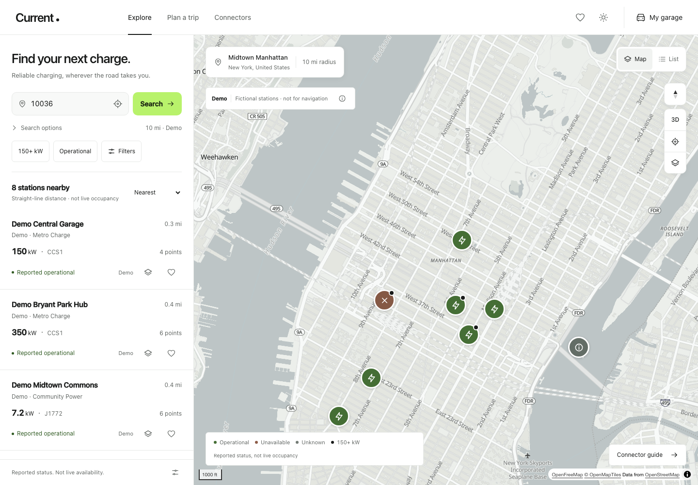

# Current — EV Charging Finder

A calm, map-first charging companion built with Flask, a FastAPI documentation gateway, MapLibre GL JS and an optional Three.js connector studio. Original procedural illustrations; no invented vehicle specifications or live charger occupancy.

**Live application:** https://ev-charging-finder-nine.vercel.app  
**Interactive API documentation:** https://ev-charging-finder-nine.vercel.app/docs  
**ReDoc:** https://ev-charging-finder-nine.vercel.app/redoc  
**GitHub Pages live client:** https://raafen.github.io/ev-charging-finder/



[Mobile screenshot](docs/media/mobile.png) · [Dark theme](docs/media/desktop-dark.png) · [Short walkthrough](docs/media/demo.webm). Captured with real ZIP-search results; station data can change.

The workspace starts with an empty station list. Enter a US ZIP code, use your location, or move the map and choose **Search this area** to request reported charging locations.

## Interface refinement

Current uses a neutral, map-first interface rather than a dashboard or landing page:

- A compact wordmark and text navigation; no decorative hero, avatars, network monograms or promotional cards.
- One primary ZIP search, a visible **Use my location** action and an always-accessible radius control. There is no manual latitude/longitude entry; connector/network/compatibility controls sit under **Filters**.
- Directly selectable station rows, separated by dividers. Power, connector, distance and reported status have a consistent hierarchy; saving and comparison remain independent actions.
- Mobile search stays accessible above the map. The station sheet has a keyboard/touch expansion control, integrated list switching and safe-area-aware navigation. Selected pins are kept clear of the sheet.
- Garage, charging estimates, network/station comparisons, trip planning and the connector guide share form, typography and control conventions. Source/freshness detail expands without hiding essential availability warnings.
- Garage manufacturer entry offers searchable native dropdown suggestions for common EV brands, while accepting custom manufacturers and preserving saved-profile editing. Suggestions do not supply or verify charging specifications.
- `static/app.css` centralizes color, geometry, spacing and motion tokens. `static/ui.js` supplies shared semantic DOM, form and action primitives. No new UI framework or runtime dependency was added.

The palette centers on `#F8F9F8`, `#181A19` and white surfaces, with `#B8F26B` reserved for primary actions and charging indicators. Small secondary text uses `#606562` instead of the lighter reference gray to retain AA contrast. Typography uses installed Inter or the platform system sans-serif—no remotely loaded font dependency. Standard transitions are 180–250 ms and respect reduced motion.

The refinement was reviewed in light/dark themes, at 320/390px mobile widths and at a 720×500 CSS-pixel reflow viewport. Automated WCAG A/AA checks were exercised on the discovery, filters, station detail, garage, network and connector surfaces; this is not a formal accessibility certification.


## Run locally

Python 3.12–3.14:

```bash
python3 -m venv .venv
source .venv/bin/activate
pip install -r requirements.txt
uvicorn main:app --host 127.0.0.1 --port 8000 --no-access-log
```

Open `http://127.0.0.1:8000`. Startup displays an empty search workspace and makes no station-provider request. Searches require a server-side `OCM_API_KEY`; without it, the app explains that live search is unavailable rather than substituting records.

[Obtain an Open Charge Map key](https://openchargemap.org/develop/api) and set `OCM_API_KEY` in the server environment. It is sent upstream only in the `X-API-Key` header, never to the browser. Environment files are not automatically loaded by Python.

```bash
python cli.py --zip 10036 --radius 10
```

## Product and data-support matrix

| Area / original feature ideas | Implemented | Conditions and boundaries |
|---|---|---|
| Map (1–24) | MapLibre vector map, pitched 3D/buildings, clusters and expansion, status pins, selected power, connector/network filters, pan-to-search, fit/recenter, compass, list mode, radius boundary, explicit fly-to, attribution and fallback | Buildings depend on vector source coverage. Terrain and satellite require configured public sources. Distances are straight-line, not driving miles. Opening details preserves desktop map position. |
| Connectors (25–40) | Reference ID/title normalization; NACS/J3400, J1772/Type 1, CCS1, CHAdeMO, Type 2, CCS2; per-connection current, power, quantity, voltage and amperage; educational guide | Missing values stay unknown. Station count, points and connectors are distinct. Power is advertised, not vehicle delivery. |
| 3D education (41–63) | Original procedural connector models, rotation/zoom/keyboard controls, comparison, labeled explanations, schematic exploded view, generic vehicle/charger illustrations, battery and energy-flow education | Three.js loads only after explicit enable in the lab. Static SVG alternatives always available. Schematics and taper curves are illustrative, not verified vehicle/site geometry. Rendering pauses offscreen and follows reduced-motion settings; DPR capped at 1.5. |
| Garage (64–80) | Multiple local manual profiles, make/model/year/trim, inlet, AC/DC limits, battery, adapters, source/date, native/adapter/incompatible/unknown results and compatible filter | No vehicle catalog configured. All specifications are user-entered. Physical fit does not prove network authorization or adapter safety. No inferred Supercharger access. |
| Networks (81–94) | Reported operator separate from host/connector, filters/chips, comparison, matching counts, preferred networks, access/payment fields and selected official links | Missing access is not public. Neutral labels; no affiliation or logo-rights claims. |
| Estimates (95–110) | Manual SOC, battery, vehicle/charger caps, charging efficiency, energy, minutes, miles, fee breakdown and two-stop comparison | Constant-power approximation. UI totals are before tax; API supports explicit tax. Missing fees remain unknown. No authoritative parsing of pricing text or verified vehicle charging-curve provider. |
| Trips (111–125) | ZIP-code origin/destination, configurable OSRM adapter, route geometry, bounded corridor sampling, driving detours, range/reserve assumptions, conditional stop suggestions, manual stops and leg navigation | Disabled until `ROUTING_BASE_URL` is configured. Pages starts with routing disabled and refreshes live backend capabilities. No live traffic. Sampled search can miss stations. Faster candidates rank detour only; API cost ranking needs manual session costs. No claim of a globally optimal charging plan. |
| Trust (126–141) | Provider/source/license, retrieval and verification timestamps, operational-vs-occupancy distinction, access/hours/pricing text, source correction links and completeness panel | Completeness is not reliability. Live availability unavailable. Photos, places/amenities and site geometry are omitted without verified, licensed data; no places provider integrated. |
| Personal (142–154) | Local favorites, searches, profiles/preferences, recent stations, three-station comparison, station/filter links, CSV export and PWA shell cache | No accounts/cross-device sync. Stored results are snapshots with retrieval timestamps. API responses and third-party tiles are not service-worker cached. First offline use requires an earlier online visit. |
| Accessibility (155–172) | Native controls, keyboard focus, dialog focus handling, live announcements, text status, reduced motion, outdoor mode, mobile sheet button, list mode, skeleton/empty/retry states, request cancellation and result preservation | Browser suite exercises narrow mobile and failed map resources. Not a formal WCAG certification. Map/3D have accessible list/static alternatives. |
| Engineering (173–197) | Station/vehicle/routing interfaces, bounded TTL caches, rate limiter, controlled retries, normalization, raw/public separation, private logs, request IDs, health/readiness, Python/browser tests, CI audit, Docker, Vercel and Pages packaging | Cache and limiter are process-local, best effort on serverless—not distributed abuse protection. Long routing searches may exceed Vercel time limits. External providers require their own licensing/capacity review. |

## Architecture and data flow

- `main.py`: FastAPI ASGI entrypoint. Hosts `/docs`, `/redoc` and `/openapi.json`; mounts the existing Flask application with `a2wsgi`. Pydantic models document the real mounted endpoints. Flask remains the single route implementation and validates input; this is not a duplicated API.
- `app.py`: HTML form fallback, JSON endpoints, capability configuration, request IDs, bounded rate limiting and privacy-conscious request logs.
- `finder.py`: input validation, normalized public station schema, distance calculation and route-corridor/stop calculations.
- `providers.py`: Open Charge Map / OSRM interfaces, timeout/retry policy and thread-safe bounded caches. Raw upstream records remain server-side.
- `domain.py`: connector normalization, manual vehicle interface, physical/network compatibility and constant-power estimates.
- `static/app.js` / `domain.js`: framework-free UI and local-first calculations. Browser preferences stay on-device. Vercel/local search uses the same-origin server API; Pages calls the configured live Vercel backend through origin-restricted CORS.
- `static/ui.js`: shared DOM, safe external links, native form fields and semantic fieldset primitives; no application state or charging rules.
- `static/explorer.js`: lazy connector studio. No Three.js or model dependency on the main search path.
- `scripts/build_vercel.py`: copies only public browser assets to the Vercel CDN directory and versions the service worker.
- `scripts/build_pages.py`: renders an empty real-data shell with relative asset paths and a public `api_base`; performs no search and exports no server code or credentials.

### API

| Method | Endpoint | Purpose |
|---|---|---|
| POST | `/api/search` | Public ZIP input or internal geolocation/map-center coordinates; radius 0–100 miles, up to 100 normalized records |
| GET | `/api/station/{id}` | Positive numeric Open Charge Map station ID |
| GET | `/api/config` | Public capability flags, never provider credentials |
| POST | `/api/compatibility` | Physical fit separate from network authorization |
| POST | `/api/estimate` | Explicit constant-power and tariff assumptions |
| POST | `/api/route` | ZIP origin/destination (`origin_zip`, `destination_zip`), configured driving route, bounded corridor and conditional plan; internal coordinate arrays also supported |
| GET | `/health`, `/ready` | Process health / capability readiness, not an upstream availability probe |

Errors include a request ID. Upstream errors are deliberately sanitized. Logs omit credentials, payloads, precise coordinates, IP addresses and query strings. Infrastructure access logging has its own privacy policy; local production command disables Uvicorn access logs.

### Technical tradeoffs

MapLibre replaces Leaflet for native vector clustering, pitched views and building extrusions. OpenFreeMap is the default public style source; OpenStreetMap attribution remains visible. A map failure does not block the station list. No elevation or satellite service is silently assumed.

Manual profiles avoid an unlicensed or stale vehicle dataset. Adapter declarations are explicit and directional. They are not electrical safety certifications. A native connector match alone cannot establish network eligibility.

The estimator uses `battery × SOC delta / efficiency / min(vehicle kW, charger kW)`. It does not model verified taper, queueing, weather or shared power. Unknown fees are not zero. The lab's taper visualization is educational only.

The route provider uses bounded sampling and a greedy range-based plan. It exposes uncertainty rather than pretending coverage or optimization. Costs are compared only with explicit numeric assumptions. Vercel is convenient for the app/API, but a container service is preferable for extensive route-corridor workloads.

### Performance budget

Owned JavaScript: **150 KiB uncompressed maximum**, checked in CI. Main map library loads separately from a pinned CDN version. Three.js is opt-in and lazy; no downloaded model assets. Map tile cache is limited to 60 tiles; normalized results are capped at 100; cluster radius is 48 pixels. Connector geometry is procedural and rendering demand-driven, with mobile DPR <=1.5. Fonts, basemap tiles and CDN scripts still require internet on first use.

## Verification

```bash
pip install -r requirements-dev.txt
python -m unittest discover -s tests -v
python -m playwright install chromium
python -m unittest discover -s tests/browser -v
python -m pip_audit -r requirements-dev.txt
python scripts/build_pages.py --output site
```

Python tests cover provider errors, cache/rate bounds, malformed data, privacy, ZIP/radius behavior, compatibility rules, charging assumptions and route calculations. Seven browser scenarios target both Flask and a `/ev-charging-finder/` Pages export: empty onboarding, real-API request URLs, ZIP/location/radius searches, result filtering and clearing, failure preservation, station-detail save/compare actions, keyboard interaction, persistent themes, mobile search access and retirement of sample records without losing real saved stations. Provider responses in these tests are explicit test-only Playwright fixtures; no fixture records ship with the application. Third-party map resources intentionally fail so list/search behavior is exercised independently.

## Deployment

See [DEPLOYMENT.md](DEPLOYMENT.md). Vercel is the primary frontend/backend deployment. GitHub Pages is an empty-start live API client, not an offline dataset. The provider key stays on Vercel; the backend permits the configured Pages origin without credentials. Docker configuration is included; Docker was unavailable on the development machine, so a local container build/run is not claimed.

## Attribution

Live charging data: [Open Charge Map and its providers](https://openchargemap.org/develop/api), under each source's license. ZIP geocoding: [Zippopotam.us / GeoNames](https://www.zippopotam.us/). Basemap: [OpenFreeMap](https://openfreemap.org/) and [OpenStreetMap contributors](https://www.openstreetmap.org/copyright). MapLibre and Three.js are BSD/MIT-licensed respectively. Interface typography uses locally available/system fonts; no proprietary font files are distributed. Connector models, SVG illustrations and app icons were created for this project; they are simplified educational depictions, not licensed manufacturer CAD. No manufacturer/network affiliation is implied. No source-code redistribution license has been chosen for this repository.
